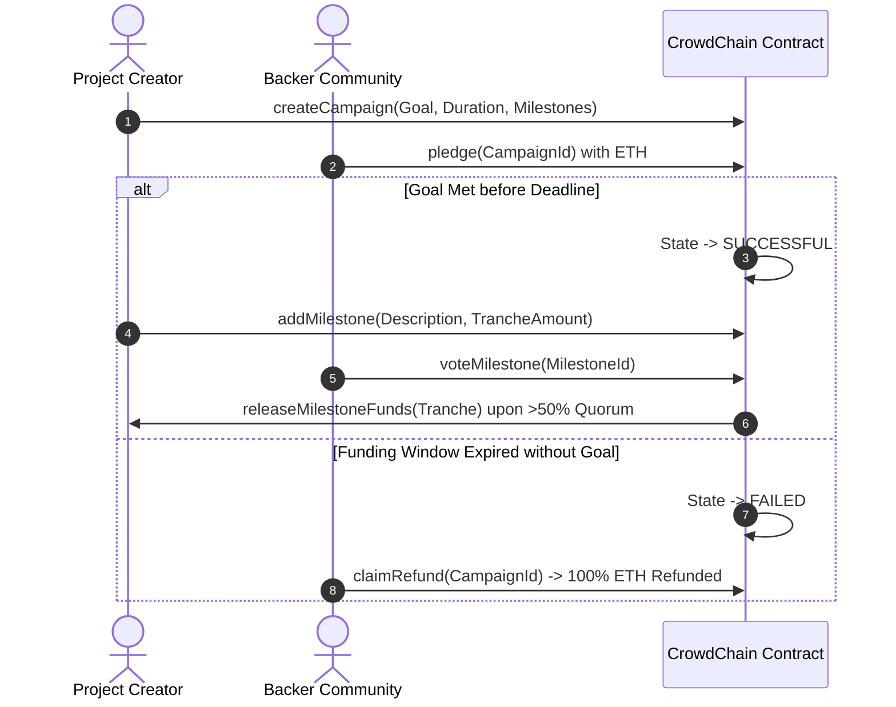

# CrowdChain — Milestone-Based Web3 Crowdfunding Platform


CrowdChain is a decentralized crowdfunding protocol featuring milestone-gated capital disbursements and backer-governed escrow release approvals. Unlike legacy Kickstarter or GoFundMe setups where creators receive lump sums upfront without delivery guarantees, CrowdChain locks pledged ETH in smart contracts, disbursing funding tranches only when verified project milestones achieve democratic backer approval (>50% quorum).

---

## Smart Contract Architecture



---

## Key Features

1. **Milestone-Gated Fund Releases:** Capital is segregated into discrete deliverables; creators cannot withdraw funds without backer approval.
2. **Guaranteed Backer Refunds:** Automatic, trustless refund claims for contributors if a campaign fails to reach its funding target before the deadline block.
3. **Quadratic & Democratic Governance:** Backers cast cryptographic votes on milestone validation with real-time quorum tracking.
4. **On-Chain Event Streaming:** Real-time synchronization between the Ethereum EVM network and the SQLite analytics gateway.
5. **Distinctive Web3 Interface:** Dark emerald aesthetic, progress gauges, live backer counter, and interactive wallet simulation.

---

## Technology Stack

- **Smart Contracts:** Solidity `^0.8.20`, OpenZeppelin patterns, EVM Sepolia testnet
- **Backend Service:** Node.js, Express.js, SQLite 3 (WAL mode)
- **Frontend:** Vanilla JavaScript (ES6+), Modern CSS Grid/Flexbox
- **Testing:** Node.js native test runner (`node:test`, `node:assert/strict`)
- **DevOps:** Docker, Docker Compose, GitHub Actions CI

---

## Local Development & Testing

```bash
# Clone the repository
git clone https://github.com/Soulofghost/crowdchain.git
cd crowdchain/backend

# Install dependencies
npm install

# Run automated test suite
npm test

# Launch local server
npm start
```
Visit `http://localhost:4023` to access the CrowdChain crowdfunding platform.

---

## Smart Contract Deployment (Sepolia)

Contract source is located at `contracts/CrowdChain.sol`. Compile and deploy with Hardhat or Foundry:
```bash
npx hardhat run scripts/deploy.js --network sepolia
```

---

## License

SPDX-License-Identifier: MIT  
Copyright (c) 2026 Alvin MS ([@Soulofghost](https://github.com/Soulofghost)).
